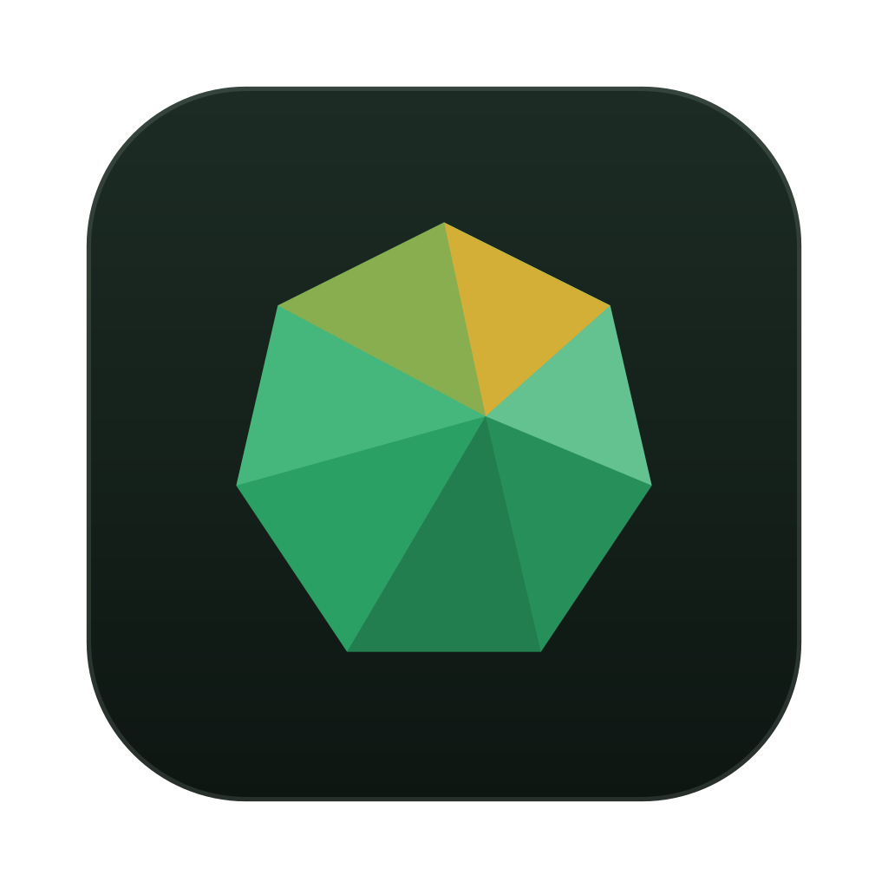

<h1 align="center">Thoughts</h1>

<b>عقلك الثاني، على جهاز Mac.</b> 
ناقش أفكارك مع الذكاء الاصطناعي، و Thoughts يحفظ لك المهم: أفكارك وملاحظاتك ومهامك، مرتّبة وملكًا لك.

<a href="README.md">English</a>

---

## برنامج يكبر معك

اعتدنا أن تكون التطبيقات منتجات مكتملة: تُبنى مرة واحدة، وتأتي بالشكل نفسه للجميع، وعليك أنت أن تتأقلم معها.
أرى أن الذكاء الاصطناعي ينهي هذا. ستصبح التطبيقات كائنات حيّة تتعلّم طريقتك في العمل وتعيد تشكيل نفسها
حولك، محادثةً بعد محادثة.

Thoughts هو محاولتي لبناء تطبيق من هذا النوع. اطلب منه عرضًا جديدًا أو طريقة عمل أو مظهرًا مختلفًا، فيبنيه
لك. ترى معاينة قبل أن يتغيّر أي شيء، وكل تغيير محفوظ بنسخته ويمكن التراجع عنه بنقرة واحدة، والتحديثات
لا تمحو ما جعلته خاصًا بك.
اقرأ: [اجعل Thoughts على مقاسك](docs/CUSTOMISING.md) (بالإنجليزية).

## ماذا يفعل

- **فكّر بصوت مسموع.** تحدّث مع مساعد ذكي عن أي شيء: مشروع لعميل، خطة، قرار.
- **لا شيء يضيع.** عند الانتهاء، يحوّل زر **تلخيص وحفظ** (Wrap) المحادثة إلى ملاحظات وأفكار ومهام
  مرتّبة. وترى ما سيُحفظ قبل حفظه.
- **أكمل من حيث توقفت.** الشاشة الرئيسية تعرض ما كنت تعمل عليه، وما هو مفتوح، وما ينتظر التلخيص.
- **ملفاتك، بصيغة بسيطة.** كل شيء ملفات نصية عادية في مجلد على جهازك. لا قيود ولا قاعدة بيانات
  مغلقة. زامنها عبر iCloud أو Dropbox أو git، أو أبقِها على جهازك فقط.
- **لمن هو؟** اليوم يناسب Thoughts أكثر من يفكّر أصلًا مع Claude ويريد أن يبقى تفكيره محفوظًا بدل
  أن يضيع في محادثات قديمة. ونعمل على تهيئته لأصحاب المهن: يسألك الإعداد عن مجال عملك (محاسبة،
  قانون، استشارات، تدريس، بحث، بناء منتج) ثم يرتّب مكتبتك حول العملاء أو القضايا أو الفصول أو
  المشاريع، مع محاضر الاجتماعات ومواعيد الاستحقاق. فعّل الإضافات التي تحتاجها وأوقف ما لا تحتاجه،
  واختر من ثلاث سمات بوضعَي النهار والليل.
- **بالعربية والإنجليزية.** دعم كامل للكتابة من اليمين إلى اليسار، والمساعد يكتب ملاحظاتك باللغة
  التي تعمل بها.

## ابدأ

1. ثبّت [Claude Code](https://claude.com/claude-code) وسجّل الدخول مرة واحدة (يتطلب ذلك اشتراكًا
   مدفوعًا في Claude أو مفتاح API). و Thoughts يتكفّل بالباقي.
2. نزّل أحدث ملف **Thoughts .dmg** من صفحة الإصدارات (Releases) واسحبه إلى مجلد التطبيقات.
3. افتح Thoughts. إعداد قصير ينشئ مكتبتك ويعرّفك بالأساسيات.

يتطلب جهاز Mac بمعالج Apple Silicon (M1 أو أحدث).

## التحديثات

يخبرك Thoughts عندما تتوفر نسخة جديدة. والتحديث لا يمسّ مكتبتك أبدًا. وإن كنت قد خصّصت التطبيق،
يقارن Thoughts ما غيّرته بالأصل، ولا يسألك إلا حيث غيّرتَ أنت والنسخة الجديدة الشيء نفسه: أبقِ
نسختي، أو استخدم الجديدة، أو دع المساعد يدمج الاثنتين.

## الخصوصية

ملفاتك تبقى على جهازك. لا يتواصل Thoughts مع الذكاء الاصطناعي إلا حين تحادثه، ولا يزامن إلا إلى
المكان الذي تحدده أنت. لا توجد إحصاءات استخدام ولا تتبّع. ويمكنك تحديد مجلدات لا يفتحها المساعد
أبدًا. التفاصيل بلغة واضحة: [docs/PRIVACY.md](docs/PRIVACY.md) (بالإنجليزية).

---

للبناء من المصدر وملاحظات البنية التقنية، انظر [docs/DEVELOPMENT.md](docs/DEVELOPMENT.md).

