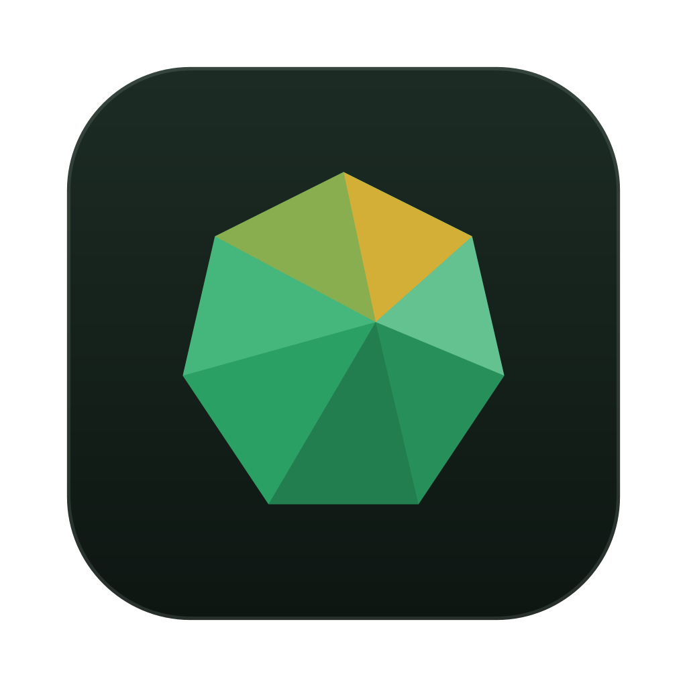

<h1 align="center">Thoughts</h1>

<b>Your second brain, on your Mac.</b> 
Talk things through with AI. Thoughts keeps what matters: ideas, notes and todos, organized and yours.

---

## Software that grows with you

Apps have always been finished products: built once, the same for everyone, and you adapt to them.
I think AI ends that. Apps will become living things that learn how you work and reshape themselves
around you, one conversation at a time.

Thoughts is my attempt to build one. Ask it for a new view, a workflow or a look, and it builds it
for you. Every change is versioned and can be undone in one click, and updates never overwrite
what you've made your own.

## What it does

- **Think out loud.** Chat with an AI assistant about anything: a client project, a plan, a decision.
- **Nothing evaporates.** When you're done, **Wrap** turns the conversation into tidy notes,
  ideas and todos. You see what will be saved before it's saved.
- **Pick up anywhere.** The home screen shows what you were working on, what's open, and what's
  waiting to be wrapped.
- **Yours, in plain files.** Everything is ordinary text files in a folder on your Mac. No lock-in,
  no proprietary database. Sync it with iCloud, Dropbox or git, or keep it local.
- **Made for anyone.** Accountants, consultants, students, founders: Thoughts adapts to how you
  work. Turn modules on and off, and pick from three themes in Day and Night.
- **English and Arabic.** Full right-to-left support.

  

## Get started

1. Install [Claude Code](https://claude.com/claude-code) and sign in once. Thoughts sets up the rest.
2. Download the latest **Thoughts .dmg** from Releases and drag it into Applications.
3. Open Thoughts. A short setup creates your library and walks you through the basics.

Requires a Mac with Apple Silicon (M1 or later).

## Updates

Thoughts updates itself. Your library is never touched by an update. If you've customized the app,
Thoughts checks what changed and asks before touching anything you made: keep it, carry it over,
or reset it.

## Privacy

Your files stay on your computer. Thoughts talks to the AI only when you chat, and syncs only
where you tell it to.

---

For building from source and architecture notes, see [docs/DEVELOPMENT.md](docs/DEVELOPMENT.md).
